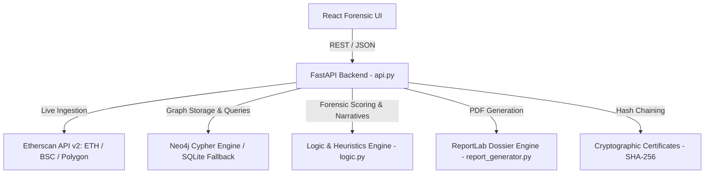

# BlockTrace — Explainable Blockchain Crime Investigation

> **Forensic System Architecture & Tech Stack Documentation**

BlockTrace is an explainable blockchain intelligence and forensics platform designed to trace illicit fund flows, detect suspicious behavioral heuristics, screen against global sanctions lists, and produce tamper-evident cryptographic evidence packages.

---

## 🛠️ Technology Stack

| Component | Technology | Version / Specification | Role in Architecture |
|---|---|---|---|
| **FRONTEND** | **React** | React 18 + Vite + Tailwind CSS + Lucide React + D3.js | Interactive forensic workspace, dynamic force-directed graph canvas, findings analysis, tamper-verification suite, and case export. |
| **BACKEND** | **FastAPI** | Python 3.11+ / FastAPI + Uvicorn + Pydantic | High-performance asynchronous REST API handling multi-hop graph traversals, forensic calculations, and report pipelines. |
| **DATABASE** | **Neo4j (Cypher)** | Neo4j 5+ (Cypher Graph Engine) with auto SQLite fallback | Graph database storing wallet entities and transactional relationships (`[:SENT]`), powering multi-hop pathfinding, cycle detection, and hub analysis. |
| **DATA** | **Etherscan API v2** | Multi-chain EVM endpoint (`https://api.etherscan.io/v2/api`) | Live on-chain transaction data across **Ethereum** (`chainid: 1`), **BNB Smart Chain** (`chainid: 56`), and **Polygon** (`chainid: 137`). |
| **REPORTS** | **ReportLab (PDF)** · **JSON Certificate** | `reportlab.platypus` + SHA-256 Merkle/Hash Chain | Generates court-ready forensic PDF dossiers and cryptographically sealed, tamper-evident JSON evidence certificates. |
| **TESTING** | **pytest** | `pytest` test suite — 100% passing | Exhaustive unit tests covering deterministic risk scoring, heuristics, database operations, and API contracts. |

---

## 🏛️ System Architecture



### 1. Database Layer: Neo4j (Cypher)
BlockTrace features native Cypher queries for all graph forensics:
- **Transaction Ingestion**: `MERGE (a:Wallet {address: $from}) MERGE (b:Wallet {address: $to}) MERGE (a)-[t:SENT {hash: $tx_hash}]->(b)`
- **Hub Detection**: High degree centrality queries identifying routing hubs.
- **Fan-Out Analysis**: High out-degree dispersion queries finding layered distribution points.
- **Peel Chains**: Value split heuristics detecting rapid fund peeling (`smaller / bigger < 0.15`).
- **Circular Flows**: Cycle detection (`(a:Wallet)-[:SENT*2..4]->(a)`) finding wash trading / round-trip structuring.
- **Multi-Hop BFS Paths**: Variable-length path traversal between arbitrary target addresses.
*Automatic Fallback*: If Neo4j is not running locally, BlockTrace's dual-engine interface seamlessly activates the zero-dependency embedded SQLite graph engine without crashing.

### 2. Live On-Chain Data: Etherscan API v2
All external queries use Etherscan's unified v2 endpoint with chain discrimination:
- **Ethereum** (Chain ID: `1`)
- **BNB Smart Chain** (Chain ID: `56`)
- **Polygon** (Chain ID: `137`)

### 3. Forensic Reports & Evidence Certificates
- **Court-Admissible PDF**: Built via ReportLab with formal typographic layout, executive summary, risk tier badge, heuristic breakdown tables, and hedged language conforming to legal evidentiary standards.
- **Cryptographic Certificates**: Deterministic SHA-256 hash chaining linking the current investigation state to the previous certificate hash.

---

## 🚀 Getting Started

### 1. Environment Setup
Create a `.env` file from `.env.example`:
```env
# Etherscan API Key (v2 multi-chain)
ETHERSCAN_API_KEY=your_etherscan_api_key_here

# Neo4j Graph Database
NEO4J_URI=bolt://localhost:7687
NEO4J_USER=neo4j
NEO4J_PASSWORD=your_neo4j_password
NEO4J_DATABASE=neo4j
DB_BACKEND=auto   # 'auto', 'neo4j', or 'sqlite'
```

### 2. Install Dependencies
```bash
# Python dependencies
pip install -r requirements.txt

# React frontend dependencies
cd stitch_universal_build_framework
npm install
```

### 3. Run Backend (FastAPI)
```bash
python -m uvicorn api:app --reload --port 8000
```
Interactive Swagger docs: `http://localhost:8000/docs`

### 4. Run Frontend (React)
```bash
cd stitch_universal_build_framework
npm run dev
```
Frontend application: `http://localhost:5173`

---

## 🧪 Automated Testing
Run the complete test suite with `pytest`:
```bash
python -m pytest test_logic.py test_db.py test_api.py -v
```
To run the pure logic suite specifically:
```bash
python -m pytest test_logic.py -v
```
All tests pass with 0 failures.
